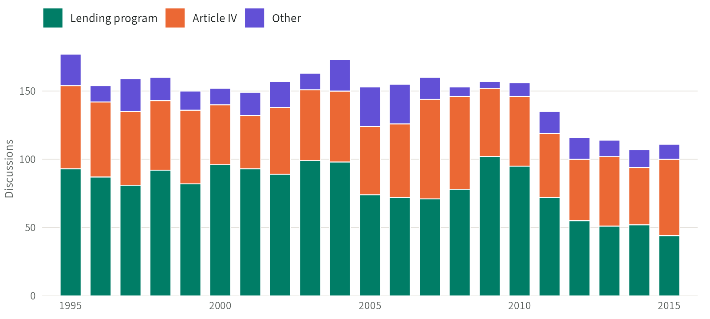

<!-- Every number in this text comes from data/datasets.yml through
     dataset-value; the sources there name the file behind each one. -->

The IMF Executive Board Minutes Dataset is a text corpus of the IMF Executive Board's discussions of individual countries in . It covers  meetings on  low- and middle-income countries, mostly on lending and economic surveillance, with more than  words of comments from Board members. For each meeting, it identifies everyone who attended and gives the full text of each comment from the Board's minutes, with the speaker's position, country, and constituency, and whether the comment was a written statement. The codebook explains how the Executive Board works and defines each variable.

## At a glance



## Downloads



## How to cite



## Figures

<!-- Drawn by R/fig-governance-meetings.R from the meeting-level data. After
     a new release, rerun it and check the alt text against the numbers it
     prints. Phones get the -narrow image. -->

::: {#fig-governance-meetings}
```{=html}
<picture>
<source media="(max-width: 575.98px)" srcset="../images/figures/governance-meetings-narrow.png" width="720" height="600">

</picture>
```

Executive Board discussions of individual countries per year, by topic, :  in all, from the meeting-level data.
:::

## Publications using the data

<!-- Source: the codebook's citation; journal details checked against
     Crossref on 20 October 2026. -->

- Forster, T., Honig, D., & Kentikelenis, A. (2025). Formal governance matters: When, how, and why states act on the IMF Executive Board. *Review of International Political Economy*, 32(3), 818–846. <https://doi.org/10.1080/09692290.2024.2441136>

## Version history


