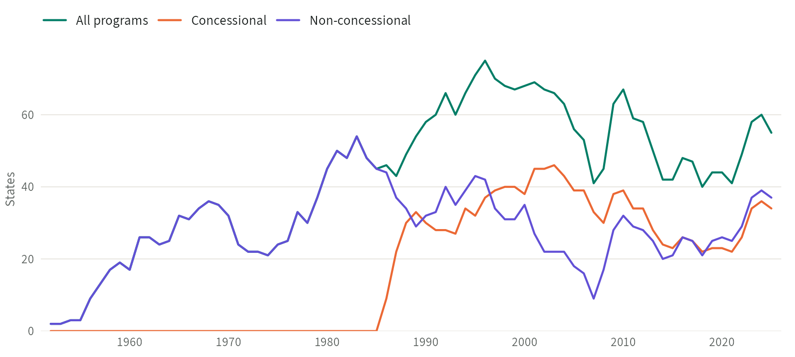

<!-- Every number in this text comes from data/datasets.yml through
     dataset-value; the sources there name the file behind each one. -->

The IMF Programs Dataset records participation in IMF lending programs in . The raw dataset lists  arrangements and outright purchases for  IMF members, with their facilities, dates, and amounts. Most come from the IMF's History of Lending Commitments page; the other  come from IMF press releases, Executive Board documents, and other IMF publications. The panel dataset turns  of these arrangements into yearly indicators for  independent states: months under a program, and whether one was in force, for all, concessional, and non-concessional programs. The codebook explains how the data were collected and built.

## At a glance



## Downloads



## How to cite



## Figures

<!-- Drawn by R/fig-programs-participation.R from the panel dataset. After a
     new release, rerun it and check the alt text against the numbers it
     prints. Phones get the -narrow image. -->

::: {#fig-programs-participation}
```{=html}
<picture>
<source media="(max-width: 575.98px)" srcset="../images/figures/programs-participation-narrow.png" width="720" height="600">

</picture>
```

States with an IMF program in force at any time in the year, , from the panel dataset. A state can have a concessional and a non-concessional program in the same year, so those two lines can add up to more than all programs. No concessional program was in force before 1986, so until then the lines for all programs and non-concessional programs coincide. Rapid disbursements and outright purchases are left out.
:::

## Related datasets

::: {.dataset-grid}

:::

## Publications using the data

<!-- Sources: the Programs codebook's "Related reference" and the June 2020
     file's notes sheet, which asks users to cite the same book. The IMF
     Monitor Dataverse collection's replication records were checked on
     21 October 2026; none says where its program data came from. Thomas,
     21 October 2026: list this one for now; he will add others later. -->

- Kentikelenis, A. & Stubbs, T. (2023). *A Thousand Cuts: Social Protection in the Age of Austerity*. Oxford University Press. <https://doi.org/10.1093/oso/9780190637736.001.0001>

## Version history


